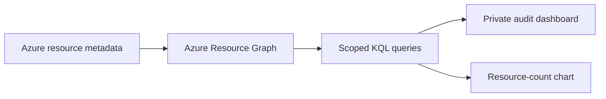

# Azure Resource Governance Dashboard

A portal-native Azure project that uses Azure Resource Graph and Kusto Query Language (KQL) to turn live resource metadata into a reusable governance dashboard.

## What I built
- A private Azure dashboard named **Identity Lab - Resource Governance**.
- A live inventory, region and tag audit table.
- A live App Service plan SKU/tier verification table.
- Three saved private Resource Graph queries.
- A resource-count bar chart tested in Resource Graph Explorer. The chart is not a dashboard tile.
- A sanitized dashboard JSON export and reusable KQL source files.

## Architecture
Azure resource metadata -> Azure Resource Graph -> scoped KQL queries -> private dashboard tables.

The project reads existing resource metadata. It does not deploy compute, change access permissions, enable paid monitoring, or modify security policies.

## Verified results
Verified in the Azure portal on November 15, 2026:

| Check | Result |
| --- | --- |
| Inventory | 2 resources: one App Service plan and one web app |
| Region | Both resources in westus3 |
| Region comparison | Both match the explicitly configured allowed-region list |
| Purpose tag coverage | Both resources lack a resource-level Purpose tag |
| Hosting plan | SKU F1, tier Free |
| Dashboard | Two private query tiles rendered live results |
| Count visualization | Bar chart showed one resource of each type |

The missing tag is an audit observation, not a claimed policy violation. A resource group's tags are not automatically inherited by child resources. This project's region comparison is a query-based check against a known list, not a complete Azure Policy compliance evaluation.

## Query design
1. **Region and tag audit**: `where` scopes the query; `extend` calculates RegionCheck and TagCheck; `project` selects the columns; `order by` makes output predictable.
2. **Resource counts**: `summarize count()` groups inventory by resource type. Explorer displays the numeric results as a bar chart.
3. **Free-tier check**: filters App Service plans and extracts `sku.name` and `sku.tier` to verify the actual plan configuration.

## Reproduce
1. Use an Azure subscription where you have read access to the resources you intend to inspect.
2. Open Resource Graph Explorer in the Azure portal.
3. Replace YOUR_SUBSCRIPTION_ID in each KQL file with your authorized subscription ID; adjust the resource group.
4. Update the allowed-region list to your actual requirements. Do not assume this example list applies to another subscription.
5. Run each query. Save each as a Private query.
6. Pin the audit and tier results to a new Private dashboard.
7. Run resource-counts.kql and choose Charts to inspect the bar chart.
8. Alternatively, customize dashboard.template.json and use the portal dashboard Upload function. This sanitized export is a template; it is not an independently tested ARM deployment package. Preserve private visibility.

## Architecture at a glance

## Repository contents
- queries/region-and-tag-audit.kql
- queries/resource-counts.kql
- queries/free-tier-check.kql
- dashboard.template.json
- README.md

## Skills demonstrated
Azure Resource Graph, KQL filtering and aggregation, dynamic property extraction, resource inventory, tagging analysis, region governance, SKU inspection, private Azure dashboards, reusable configuration, and technical documentation.

## Scope and cost
Resource Graph is a free service. The checks use existing metadata and create no billable runtime resources. The tier result verifies configuration, not the entire subscription bill or a spending cap. This is a resource-governance project, not Entra tenant administration or a completed authentication application.

## References
- https://learn.microsoft.com/en-us/azure/governance/resource-graph/overview
- https://learn.microsoft.com/en-us/azure/governance/resource-graph/first-query-portal
- https://learn.microsoft.com/en-us/azure/governance/resource-graph/tutorials/create-share-query

